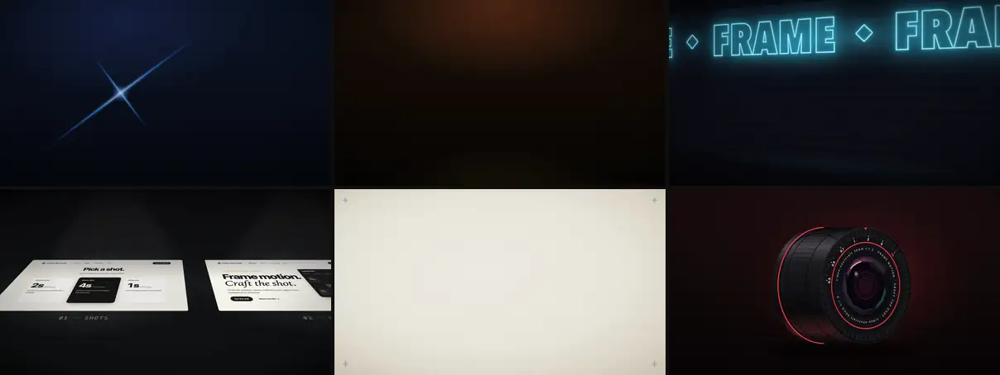
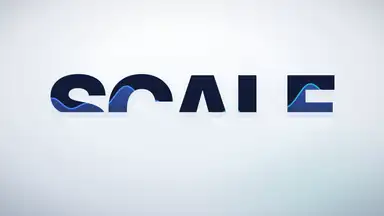
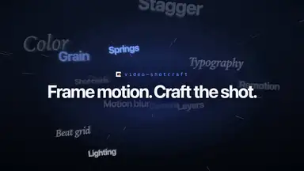
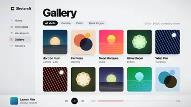
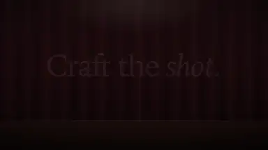
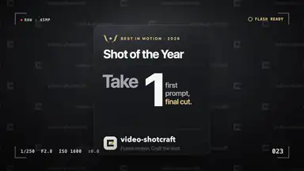
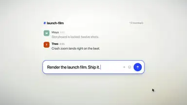

<div align="center">

<picture>
  <source media="(prefers-color-scheme: dark)" srcset="./assets/brand/logo-mark-reverse.svg">
  <source media="(prefers-color-scheme: light)" srcset="./assets/brand/logo-mark.svg">
  
</picture>

# video-shotcraft

**English** | [中文](README_CN.md) | [日本語](README_JA.md) | [Русский](README_RU.md)

[](https://vincentwei1021.github.io/video-shotcraft/)
[](https://vincentwei1021.github.io/video-shotcraft/showcase.html)

[](https://github.com/Vincentwei1021/video-shotcraft/stargazers)
[](LICENSE)
[](SKILL.md)
[](SKILL.md)
[](https://atomgit.com/VincentWei/video-shotcraft)

<a href="https://trendshift.io/repositories/88911?utm_source=repository-badge&amp;utm_medium=badge&amp;utm_campaign=badge-repository-88911" target="_blank" rel="noopener noreferrer"></a>



[**▶ Browse all 150 shots in the Gallery**](https://vincentwei1021.github.io/video-shotcraft/) · [**🎬 Watch the Showcase**](https://vincentwei1021.github.io/video-shotcraft/showcase.html)

</div>

## What it does

Tell Claude Code or Codex "make a promo for my product". The agent captures your real pages, picks shots
from a library of tuned motion recipes, storyboards the film, animates it with
[Remotion](https://www.remotion.dev/), cuts it to the beat, adds sound design, checks every frame and hands you
a finished MP4 you can keep editing.

It is not a video generator. Every frame is drawn by code from your own screenshots and copy, so the result is
sharp, on-brand and fully editable.

**How it works**


## What's new

> [!IMPORTANT]
> ### 🎬 2026-10 · Shot library refresh
> All 216 demos were polished and reviewed. The best versions now make up
> **124 cards / 150 shots**, with fresh Gallery previews and video-shotcraft branding.

- **2026-09 · [Motion Workbench](#motion-workbench).** Keep editing the delivered film in a CapCut-style browser editor.
- **2026-08 · [video-talkcraft](https://github.com/Vincentwei1021/video-talkcraft)**, the narration-video
  sibling: script + voiceover in, every motion beat locked to the voice
  ([78 narration previews](https://vincentwei1021.github.io/video-talkcraft/)).
- **2026-08 · JianYing (CapCut CN) export.** The final film becomes an editable JianYing draft: per-shot clips,
  native caption tracks, separate SFX/BGM tracks. Verified on JianYing Pro 11.2 for macOS
  ([guide](references/jianying-export.md)).

## ❤️ Sponsors

<table>
<tr>
<td align="center" valign="middle" width="25%">
  <a href="https://go.apimart.ai/tw-video-shotcraft"></a><br>
  <a href="https://go.apimart.ai/tw-video-shotcraft"><b>APIMart</b></a>
</td>
<td>
  <p>Thanks to APIMart for sponsoring this project! APIMart is a low-cost API platform for AI image &amp; video generation — GPT-Image-2 from $0.006/image, 160+ images per dollar. One async API covers both image and video: submit a task, get an ID, fetch results via polling or callback. Batch tens of thousands of images without timeouts, switch models without changing code. Pay-as-you-go with no monthly fee — <a href="https://go.apimart.ai/tw-video-shotcraft">sign up here</a> to get started.</p>
</td>
</tr>
<tr>
<td align="center" valign="middle" width="25%">
  <a href="https://www.packyapi.ai/register?aff=l9IZ"></a><br>
  <a href="https://www.packyapi.ai/register?aff=l9IZ"><b>PackyCode</b></a>
</td>
<td>
  <p>Access leading AI models through PackyCode with one API endpoint and one API key. Enjoy fast, reliable access with automatic failover and dedicated high-speed routes for Codex and Claude Code.</p>
  <p>Get started with $1 in free credits, a discount on your first top-up, and savings of up to 80% on eligible routes. Pay in RMB with no currency conversion markups or extra top-up fees.</p>
  <p><a href="https://www.packyapi.ai/register?aff=l9IZ">Get started with PackyCode →</a></p>
</td>
</tr>
<tr>
<td align="center" valign="middle" width="25%">
  <a href="https://aws.amazon.com/"></a><br>
  <a href="https://aws.amazon.com/"><b>AWS</b></a>
</td>
<td>
  <p>Amazon Web Services (AWS) offers reliable, scalable cloud computing services, including compute, storage and AI.</p>
  <p><a href="https://aws.amazon.com/">Explore AWS →</a></p>
</td>
</tr>
</table>

## Install

Built and tuned for Claude Code and Codex. The simplest way is to hand your agent the link:

```text
Install this skill for me: https://github.com/Vincentwei1021/video-shotcraft
```

Or with the [skills](https://skills.sh/) CLI:

```bash
npx skills add Vincentwei1021/video-shotcraft
```

Or by hand:

```bash
git clone https://github.com/Vincentwei1021/video-shotcraft.git
cd video-shotcraft
ln -s "$(pwd)" ~/.claude/skills/video-shotcraft   # Claude Code
ln -s "$(pwd)" ~/.codex/skills/video-shotcraft    # Codex
```

In mainland China, clone from the AtomGit mirror if GitHub is slow:
`git clone https://atomgit.com/VincentWei/video-shotcraft.git`.

## Use

Just describe the film. No command needed.

| Say | What happens |
|---|---|
| `Use video-shotcraft to make a promo for my product.` | The agent introduces the Ink Press template and asks whether to use it, then captures your pages and builds the film |
| `Make a launch film for this repo with the Ink Press template.` | The fastest path: your screenshots, copy and logo dropped into a validated template |
| `Use the deck-deal-flyin and row-embed shot cards to present this feature.` | You pick the shots by name (copy names straight from the Gallery) |
| `Design a product close-up inspired by spotlight-hero-card.` | One shot, adapted to your product |

## Shot library

124 recipe cards in 10 categories, 150 shots in total. Search, filter and copy card names in the
[Gallery](https://vincentwei1021.github.io/video-shotcraft/).

<table>
<tr>
<td align="center" width="50%"><b>Opening & Brand</b> · 11 shots<br><br><sub>text-as-mask: the product shows through the title</sub></td>
<td align="center" width="50%"><b>Camera</b> · 13 shots<br><br><sub>exploded-view: the page tilts and comes apart</sub></td>
</tr>
<tr>
<td align="center" width="50%"><b>Transitions</b> · 19 shots<br><br><sub>card-flock-tumble: a flock of cards becomes the headline</sub></td>
<td align="center" width="50%"><b>Typography</b> · 25 shots<br><br><sub>flying-words: a word tunnel resolves into the motto</sub></td>
</tr>
<tr>
<td align="center" width="50%"><b>UI Entrance</b> · 22 shots<br><br><sub>card-stack: a fan of cards deals into place</sub></td>
<td align="center" width="50%"><b>Interaction</b> · 13 shots<br><br><sub>palette-theme-ripple: a new theme ripples across the UI</sub></td>
</tr>
<tr>
<td align="center" width="50%"><b>Data</b> · 9 shots<br><br><sub>axis-rescale-shock: the spike breaks the axis</sub></td>
<td align="center" width="50%"><b>Light & Emphasis</b> · 23 shots<br><br><sub>spotlight-sweep: a stage light finds the title</sub></td>
</tr>
<tr>
<td align="center" width="50%"><b>Rhythm</b> · 8 shots<br><br><sub>paparazzi-flash: three flashes, three crops, one number</sub></td>
<td align="center" width="50%"><b>Outro</b> · 7 shots<br><br><sub>input-morph-assemble: the chat box builds the logo</sub></td>
</tr>
</table>

Each card lives in `references/shots/<category>/<card>.md`, with its Remotion implementation in
`demos/<category>/<card>/` (see [demos/README.md](demos/README.md) for how to wire one into your project).

## Motion Workbench

After delivery the skill opens a CapCut-style editor in your browser
(`node workbench/scripts/open.mjs <project>`). The film is split into shot, transition, caption and SFX tracks
exactly as authored. Select any shot to edit its copy, font sizes and colours, move, trim or speed-ramp clips,
drag in any of the 150 library shots, then export with Remotion. Preview and render are frame-identical.


[Workbench guide, every panel with screenshots](workbench/GUIDE.md) (Chinese) ·
[Integration contract](references/workbench.md)

## What you get

| Output | Details |
|---|---|
| Final film | `MP4`, 1920×1080, 30 fps, h264, with music and sound design |
| Remotion project | The full source of your film: every shot is a React component you or the agent can change |
| Motion Workbench | Opens after delivery: tracks, inspector, retime, swap shots, export ([details](#motion-workbench)) |
| JianYing draft | Optional: an editable JianYing (CapCut CN) project with per-shot clips, captions and audio tracks |
| Social publishing | Optional, when you ask: publish the finished film via Upload-Post to TikTok, Instagram, YouTube, LinkedIn, X and more. Confirm caption and platforms, then dry-run before posting ([guide](references/publish-upload-post.md)) |

Also in the box: reusable Remotion components (2.5D page camera, captions, flash cuts, digit rolls), Freesound SFX search/download tools and
5 BGM tracks, page-capture scripts, and the production method itself (capture, visual direction, storyboarding,
sound design, beat sync, final QA) in [references/](references/pipeline.md).

## Showcase

**Share your film.** Made something with video-shotcraft?
[Submit it](https://github.com/Vincentwei1021/video-shotcraft/issues/new?template=showcase.yml) with the
Showcase issue form. After review it appears on the
[Showcase page](https://vincentwei1021.github.io/video-shotcraft/showcase.html).

## Requirements

| Needs | For |
|---|---|
| Node.js and npm | Remotion rendering, the template and the workbench |
| ffmpeg / ffprobe | Frame checks and final QA |
| [uv](https://docs.astral.sh/uv/) | Only for BGM beat analysis (runs a one-off Python script) |
| puppeteer | Only for page capture; the capture script installs it on demand |

Remotion downloads its own headless Chrome on first render. Tested on macOS; Linux works with the notes below.

<details>
<summary><b>Headless Linux / CI notes</b></summary>

Rendering on a headless Linux box (tested: 2 cores, Node 22) hits three walls:

1. **Concurrency cap.** `remotion still/render` fails with "Maximum for --concurrency is 2" on low-core
   machines. Pass `--concurrency=1`.
2. **Old headless removal.** Recent Chrome/Chromium dropped the old headless mode, so pointing Remotion at
   system Chromium fails to launch. Use a chrome-headless-shell binary instead of full Chrome.
3. **Blocked CDN.** If remotion.media is unreachable (common in mainland China), the automatic headless-shell
   download fails. Pass `--browser-executable=<path-to-local chrome-headless-shell>`.

With these three flags, frame renders from the bundled template work.

</details>

<details>
<summary><b>Repository structure</b></summary>

```text
video-shotcraft/
├── SKILL.md                 # Agent entry point and core production rules
├── references/
│   ├── pipeline.md          # End-to-end production workflow
│   ├── shots/               # 124 shot recipe cards in 10 functional categories
│   ├── sequences/           # Reusable full-video structures and sequence patterns
│   ├── aesthetic-rules.md   # Visual QA criteria
│   ├── music-beat-sync.md   # BGM analysis and beat-sync methodology
│   ├── sound-design.md      # Sound-design guidance and examples
│   ├── sfx-sourcing.md      # Freesound search, download, analysis and credits
│   ├── jianying-export.md   # JianYing (CapCut CN) project-export guide
│   ├── publish-upload-post.md # Optional social publishing (Upload-Post API)
│   └── workbench.md         # Motion workbench: manifest contract + editability rules
├── demos/                   # Remotion reference implementations (same categories)
├── gallery/                 # Static motion-preview Gallery
├── template/                # Runnable complete video template
├── jianying-export/         # JianYing draft installers (mac tested / win untested)
├── publish/                 # Optional social publisher (stdlib-only Python) + offline tests
├── workbench/               # Post-delivery motion workbench (Vite + Remotion Player)
└── assets/
    ├── lib/                 # Reusable Remotion components
    ├── scripts/             # Page capture + Freesound CLI and offline tests
    └── audio/
        └── bgm/             # 5 BGM options; SFX downloaded per project
```

For the full workflow see [SKILL.md](SKILL.md), the [production pipeline](references/pipeline.md) and the
[visual QA criteria](references/aesthetic-rules.md).

</details>

## Audio and assets

SFX come directly from [Freesound](https://freesound.org), downloaded into each video's project.
The shared SFX library has been removed. The [sourcing guide](references/sfx-sourcing.md) covers search,
CC0 / CC BY filtering, MP3 preview downloads, measurements and source/credit manifests. The Python CLI
uses the standard library; downloading and analysis require FFmpeg. No API key is needed.
[Sound design](references/sound-design.md) covers timing and mixing. The template retains its fixed
historical audio for playback and regression checks; new product videos source their SFX from Freesound.
BGM options remain in `assets/audio/bgm/`.

Product screenshots bundled with the template are demonstration assets. Replace them with screenshots of your
product before publishing, and check whether any product, customer or personal data needs to be anonymized.

## License

- Code and docs: [Apache-2.0](LICENSE).
- Freesound audio: each file under its recorded license; retain the project manifest and publish required CC BY credits.
- BGM: see [ATTRIBUTION.md](assets/audio/ATTRIBUTION.md). Historical template audio: see [template credits](template/public/audio/ATTRIBUTION.md).
- [Remotion](https://www.remotion.dev/) has its own
  [license](https://github.com/remotion-dev/remotion/blob/main/LICENSE.md): free for individuals and small
  teams, companies may need a paid license.

## Acknowledgements

Many recipes were distilled by studying the motion language of outstanding official product films, including
promos from **ClickUp, Perplexity, Slack, Notion, Figma, Framer, Bear, Raycast, Pitch, Miro, Superhuman and
Loom**. The cards document techniques (timing, easing, choreography) re-implemented from scratch; no footage,
artwork or brand assets from these films are included. All trademarks belong to their owners, and none of these
companies are affiliated with or endorse this project.

The Freesound sourcing workflow was inspired by **[vibe-motion/sound](https://github.com/vibe-motion/sound)**.
Thanks to its authors for sharing the approach of selecting sounds by source descriptions, duration,
download counts, rating counts and licenses. Video Shotcraft's search/download CLI is independently implemented.

Thanks also to **[Remotion](https://www.remotion.dev/)**, which powers every demo and template here;
**[Freesound](https://freesound.org)** and its contributors for project SFX;
**[Mixkit](https://mixkit.co/)** for BGM and historical template audio; the game-feel
and animation communities whose published principles inform several cards; and **Claude Code**, with which this
library was built, iterated and QA'd using the same workflow the skill teaches.

## Follow me

<p>
  <a href="https://x.com/VincentWei93"></a>
  <a href="https://www.douyin.com/user/MS4wLjABAAAAK1pkjBxilk2Oi_9h_vFyD-lTAu9CTlvhmOtkosDvvxg"></a>
  <a href="https://xhslink.cn/m/At9iP2d5C1V"></a>
</p>

## Star history

<a href="https://www.star-history.com/?repos=Vincentwei1021%2Fvideo-shotcraft&type=date&legend=top-left">
  <picture>
    <source media="(prefers-color-scheme: dark)" srcset="https://api.star-history.com/chart?repos=Vincentwei1021/video-shotcraft&type=date&theme=dark&legend=top-left&sealed_token=DQ8_yn0k8in6tP80CRd9Ghuk1fcdEW7poFh9ticGB3wMNO-E_i6g51sUiQWCAQYP0u0bjRweuIfGoRS8FnrIz86oFp1lcl5zu2vrEJrQOoNvwdUSwmm8XNPkAiln1o-EBAX0uU8k6ReIlSRufGLqpoxsWshMSZ9mmok6ox5XXIUO77b7zOgp2yRIH6yR" />
    <source media="(prefers-color-scheme: light)" srcset="https://api.star-history.com/chart?repos=Vincentwei1021/video-shotcraft&type=date&legend=top-left&sealed_token=DQ8_yn0k8in6tP80CRd9Ghuk1fcdEW7poFh9ticGB3wMNO-E_i6g51sUiQWCAQYP0u0bjRweuIfGoRS8FnrIz86oFp1lcl5zu2vrEJrQOoNvwdUSwmm8XNPkAiln1o-EBAX0uU8k6ReIlSRufGLqpoxsWshMSZ9mmok6ox5XXIUO77b7zOgp2yRIH6yR" />
    
  </picture>
</a>
