<div align="center">

<picture>
  <source media="(prefers-color-scheme: dark)" srcset="./assets/brand/logo-mark-reverse.svg">
  <source media="(prefers-color-scheme: light)" srcset="./assets/brand/logo-mark.svg">
  
</picture>

# video-shotcraft

<a href="#support"></a>

[English](README.md) | [中文](README_CN.md) | [繁體中文](README_TW.md) | [日本語](README_JA.md) | [Русский](README_RU.md) | **Türkçe**

[](https://vincentwei1021.github.io/video-shotcraft/) <a href="#wechat-community"></a>
[](https://vincentwei1021.github.io/video-shotcraft/showcase.html)

[](https://github.com/Vincentwei1021/video-shotcraft/stargazers)
[](LICENSE)
[](SKILL.md)
[](SKILL.md)
[](https://atomgit.com/VincentWei/video-shotcraft)

<a href="https://trendshift.io/repositories/88911?utm_source=repository-badge&amp;utm_medium=badge&amp;utm_campaign=badge-repository-88911" target="_blank" rel="noopener noreferrer"></a>

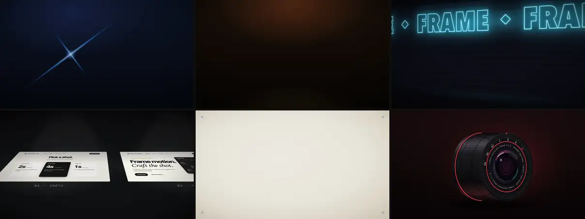

[**▶ Galerideki 150 çekimin tamamına göz atın**](https://vincentwei1021.github.io/video-shotcraft/) · [**🎬 Vitrini izleyin**](https://vincentwei1021.github.io/video-shotcraft/showcase.html)

</div>

## Ne işe yarar?

Claude Code veya Codex'e "ürünüm için bir tanıtım filmi yap" deyin. Ajan gerçek sayfalarınızın ekran görüntüsünü alır, ince ayarlı hareket tarifleri kitaplığından çekimler seçer, filmin storyboard'unu kurar, [Remotion](https://www.remotion.dev/) ile canlandırır, müziğin ritmine göre keser, ses tasarımı ekler, her kareyi denetler ve düzenlemeye devam edebileceğiniz hazır bir MP4 teslim eder.

Bu bir yapay zeka video üreticisi değildir. Her kare, kendi ekran görüntüleriniz ve metinleriniz kullanılarak kodla çizilir; bu yüzden sonuç keskin, markanızla uyumlu ve tamamen düzenlenebilir olur.

**Nasıl çalışır?**


## Yenilikler

> [!IMPORTANT]
> ### 🎬 2026-10 · Çekim kitaplığı yenilemesi
> 216 demonun tamamı elden geçirildi ve incelendi. En iyi sürümler artık
> **124 kart / 150 çekim** olarak yeni Galeri önizlemeleri ve video-shotcraft markasıyla sunuluyor.

- **2026-09 · [Motion Workbench](#motion-workbench).** Teslim edilen filmi tarayıcıda CapCut tarzı bir düzenleyicide düzenlemeye devam edin.
- **2026-08 · [video-talkcraft](https://github.com/Vincentwei1021/video-talkcraft)**, seslendirmeli anlatım videosu kardeşi: metin + seslendirme verin, her hareket vuruşu sese kilitlensin ([78 anlatım önizlemesi](https://vincentwei1021.github.io/video-talkcraft/)).
- **2026-08 · JianYing (CapCut CN) dışa aktarımı.** Son film düzenlenebilir bir JianYing taslağına dönüşür: çekim bazlı klipler, yerel altyazı kanalları ve ayrı SFX/BGM kanalları. macOS için JianYing Pro 11.2 üzerinde doğrulandı ([kılavuz](references/jianying-export.md)).

## ❤️ Sponsorlar

<table>
<tr>
<td align="center" valign="middle" width="25%">
  <a href="https://apinebula.ai/ref/HLROcb4p">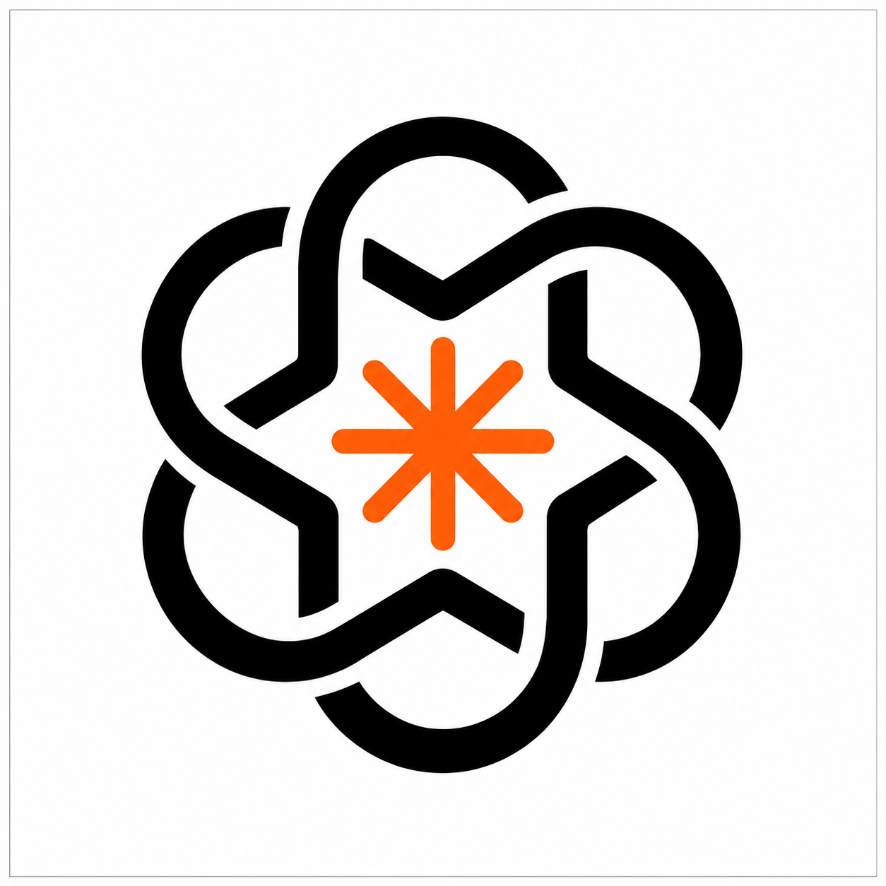</a><br>
  <a href="https://apinebula.ai/ref/HLROcb4p"><b>APINEBULA</b></a>
</td>
<td>
  <p>Bu projeye sponsor olduğu için APINEBULA'ya teşekkürler! APINEBULA, 银河录像局 tarafından işletilen kurumsal düzeyde bir yapay zeka API toplama platformudur. Geliştiriciler, ekipler ve kurumlar için büyük dil modeli API'lerine kararlı ve uygun maliyetli erişim sağlar; tek bir API üzerinden Claude, GPT, Gemini ve diğer önde gelen modellere normal fiyatın %6'sından başlayan fiyatlarla ulaşabilirsiniz.</p>
  <p><a href="https://apinebula.ai/ref/HLROcb4p">Bu bağlantıdan kayıt olun</a> ve bakiye yüklerken <b>video</b> promosyon kodunu girerek <b>%10 indirim</b> kazanın.</p>
</td>
</tr>
<tr>
<td align="center" valign="middle" width="25%">
  <a href="https://www.openlux.ai/register?channel=c_n68puogw">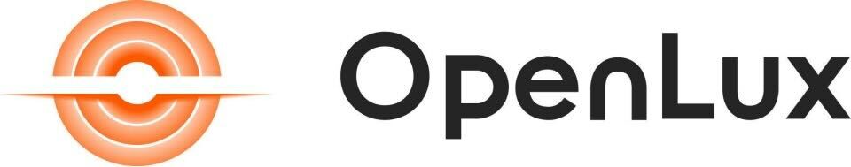</a><br>
  <a href="https://www.openlux.ai/register?channel=c_n68puogw"><b>OpenLux</b></a>
</td>
<td>
  <p>Bu projeye sponsor olduğu için OpenLux'a teşekkürler! OpenLux, dünyanın önde gelen sağlayıcılarının yapay zeka modellerini bir araya getiren hepsi bir arada bir iş platformudur. Hızlı, güvenilir hizmet ve teknik destekle Claude, OpenAI ve Gemini modellerinde resmi fiyatların sırasıyla %8,82, %4 ve %8'ine varan temel fiyatlandırma sunar.</p>
  <p>video-shotcraft kullanıcılarına özel teklif: Referans bağlantımız üzerinden kayıt olun ve kredi yüklemelerinde %7,5'e varan indirimden yararlanın!</p>
  <p><a href="https://www.openlux.ai/register?channel=c_n68puogw">OpenLux ile başlayın →</a></p>
</td>
</tr>
<tr>
<td align="center" valign="middle" width="25%">
  <a href="https://aws.amazon.com/"></a><br>
  <a href="https://aws.amazon.com/"><b>AWS</b></a>
</td>
<td>
  <p>Amazon Web Services (AWS); işlem gücü, depolama ve yapay zeka dahil güvenilir ve ölçeklenebilir bulut bilişim hizmetleri sunar.</p>
  <p><a href="https://aws.amazon.com/">AWS'yi keşfedin →</a></p>
</td>
</tr>
</table>

## Kurulum

Claude Code ve Codex için geliştirilmiş ve ince ayarlanmıştır. En kolay yol bağlantıyı doğrudan ajanınıza vermektir:

```text
Install this skill for me: https://github.com/Vincentwei1021/video-shotcraft
```

Veya [skills](https://skills.sh/) CLI ile:

```bash
npx skills add Vincentwei1021/video-shotcraft
```

Ya da elle kurulum:

```bash
git clone https://github.com/Vincentwei1021/video-shotcraft.git
cd video-shotcraft
ln -s "$(pwd)" ~/.claude/skills/video-shotcraft   # Claude Code
ln -s "$(pwd)" ~/.codex/skills/video-shotcraft    # Codex
```

Çin anakarasında GitHub yavaşsa AtomGit yansısından klonlayabilirsiniz:
`git clone https://atomgit.com/VincentWei/video-shotcraft.git`.

## Kullanım

Sadece filmi tarif edin; özel bir komut gerekmez.

| Ne dersiniz? | Ne olur? |
|---|---|
| `Use video-shotcraft to make a promo for my product.` | Ajan Ink Press şablonunu tanıtır, kullanmak isteyip istemediğinizi sorar, sayfalarınızı yakalar ve filmi oluşturur |
| `Make a launch film for this repo with the Ink Press template.` | En hızlı yol: ekran görüntüleriniz, metinleriniz ve logonuz doğrulanmış bir şablona yerleştirilir |
| `Use the deck-deal-flyin and row-embed shot cards to present this feature.` | Çekimleri adıyla kendiniz seçersiniz (adları doğrudan Galeriden kopyalayabilirsiniz) |
| `Design a product close-up inspired by spotlight-hero-card.` | Ürünüze uyarlanmış tek bir çekim tasarlanır |

## Çekim kitaplığı

10 kategoride 124 tarif kartı, toplam 150 çekim. [Galeride](https://vincentwei1021.github.io/video-shotcraft/) arama yapın, filtreleyin ve kart adlarını kopyalayın.

<table>
<tr>
<td align="center" width="50%"><b>Açılış ve Marka</b> · 11 çekim<br>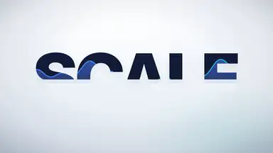<br><sub>text-as-mask: ürün başlığın içinden görünür</sub></td>
<td align="center" width="50%"><b>Kamera</b> · 13 çekim<br>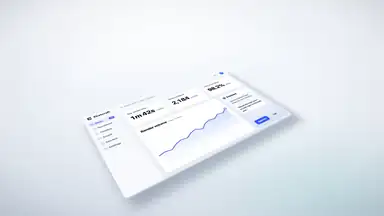<br><sub>exploded-view: sayfa eğilir ve katmanlarına ayrılır</sub></td>
</tr>
<tr>
<td align="center" width="50%"><b>Geçişler</b> · 19 çekim<br>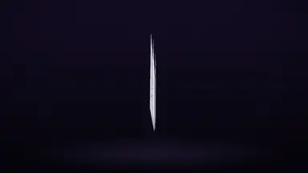<br><sub>card-flock-tumble: kart sürüsü ana başlığa dönüşür</sub></td>
<td align="center" width="50%"><b>Tipografi</b> · 25 çekim<br>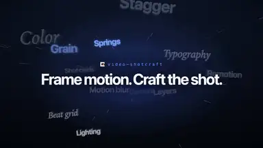<br><sub>flying-words: kelime tüneli sloganda birleşir</sub></td>
</tr>
<tr>
<td align="center" width="50%"><b>Arayüz Girişi</b> · 22 çekim<br><br><sub>card-stack: kart yelpazesi yerine dağılır</sub></td>
<td align="center" width="50%"><b>Etkileşim</b> · 13 çekim<br>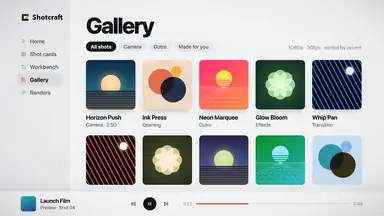<br><sub>palette-theme-ripple: yeni tema arayüzde dalgalanır</sub></td>
</tr>
<tr>
<td align="center" width="50%"><b>Veri</b> · 9 çekim<br><br><sub>axis-rescale-shock: ani yükseliş ekseni yeniden ölçekler</sub></td>
<td align="center" width="50%"><b>Işık ve Vurgu</b> · 23 çekim<br>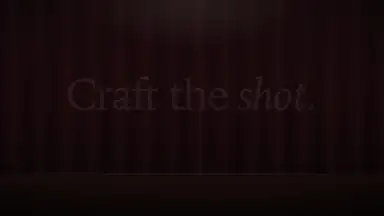<br><sub>spotlight-sweep: sahne ışığı başlığı aydınlatır</sub></td>
</tr>
<tr>
<td align="center" width="50%"><b>Ritim</b> · 8 çekim<br>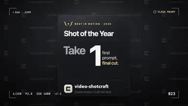<br><sub>paparazzi-flash: üç flaş, üç kadraj, tek sayı</sub></td>
<td align="center" width="50%"><b>Kapanış</b> · 7 çekim<br>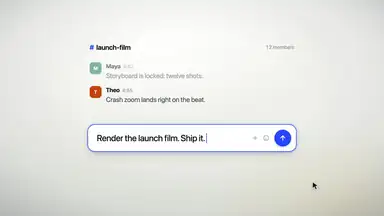<br><sub>input-morph-assemble: sohbet kutusu logoyu oluşturur</sub></td>
</tr>
</table>

Her kart `references/shots/<kategori>/<kart>.md` altında, Remotion uygulaması ise `demos/<kategori>/<kart>/` altında bulunur (bir kartı projenize nasıl bağlayacağınız için bkz. [demos/README.md](demos/README.md)).

## Motion Workbench

Teslimattan sonra skill tarayıcınızda CapCut tarzı bir düzenleyici açar (`node workbench/scripts/open.mjs <proje>`). Film; çekim, geçiş, altyazı ve SFX kanallarına tam olarak kurgulandığı gibi ayrılır. Herhangi bir çekimi seçip metnini, yazı boyutunu ve renklerini düzenleyin, klipleri taşıyın, kırpın veya hız rampası ekleyin, kitaplıktaki 150 çekimden istediğinizi sürükleyin ve Remotion ile dışa aktarın. Önizleme ve render kare kare özdeştir.

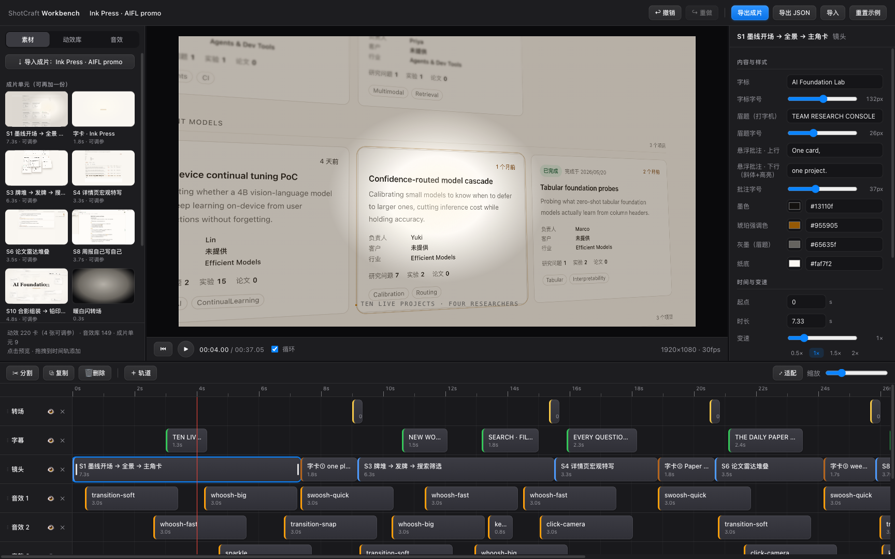

[Workbench kılavuzu, ekran görüntülü tüm paneller](workbench/GUIDE.md) (Çince) ·
[Entegrasyon sözleşmesi](references/workbench.md)

## Ne elde edersiniz?

| Çıktı | Ayrıntılar |
|---|---|
| Son film | `MP4`, 1920×1080, 30 fps, h264, müzik ve ses tasarımıyla |
| Remotion projesi | Filminizin tam kaynak kodu: her çekim sizin veya ajanın değiştirebileceği bir React bileşenidir |
| Motion Workbench | Teslimattan sonra açılır: kanallar, denetçi, yeniden zamanlama, çekim değiştirme, dışa aktarma ([ayrıntılar](#motion-workbench)) |
| JianYing taslağı | İsteğe bağlı: çekim bazlı klipler, altyazılar ve ses kanallarıyla düzenlenebilir JianYing (CapCut CN) projesi |
| Sosyal medya yayını | İsteğe bağlı, istediğinizde: bitmiş filmi Upload-Post üzerinden TikTok, Instagram, YouTube, LinkedIn, X ve daha fazlasında yayınlayın. Açıklamayı ve platformları onaylayın, paylaşmadan önce dry-run yapın ([kılavuz](references/publish-upload-post.md)) |

Ayrıca pakette: yeniden kullanılabilir Remotion bileşenleri (2.5B sayfa kamerası, altyazılar, flaş kesmeleri, sayaç animasyonları), Freesound SFX arama/indirme araçları, 5 BGM parçası, sayfa yakalama betikleri ve [references/](references/pipeline.md) altında eksiksiz yapım yöntemi bulunur.

## Vitrin (Showcase)

**Filminizi paylaşın.** video-shotcraft ile bir şey mi yaptınız?
Vitrin issue formuyla [gönderin](https://github.com/Vincentwei1021/video-shotcraft/issues/new?template=showcase.yml); incelemeden sonra [Vitrin sayfasında](https://vincentwei1021.github.io/video-shotcraft/showcase.html) yayınlanır.

## Gereksinimler

| Gereksinim | Kullanım amacı |
|---|---|
| Node.js ve npm | Remotion render, şablon ve workbench |
| ffmpeg / ffprobe | Kare kontrolleri ve son QA |
| [uv](https://docs.astral.sh/uv/) | Yalnızca BGM ritim analizi için (tek seferlik Python betiği çalıştırır) |
| puppeteer | Yalnızca sayfa yakalama için; yakalama betiği gerektiğinde kendisi kurar |

Remotion ilk render'da kendi headless Chrome sürümünü indirir. macOS üzerinde test edilmiştir; Linux aşağıdaki notlarla çalışır.

<details>
<summary><b>Headless Linux / CI notları</b></summary>

Headless bir Linux makinesinde render almak (test edilen: 2 çekirdek, Node 22) üç engelle karşılaşır:

1. **Eşzamanlılık sınırı.** Düşük çekirdekli makinelerde `remotion still/render`, "Maximum for --concurrency is 2" hatası verir. `--concurrency=1` geçin.
2. **Eski headless modunun kaldırılması.** Güncel Chrome/Chromium eski headless modunu kaldırdığı için Remotion'ı sistem Chromium'una yönlendirmek başlatma hatası verir. Tam Chrome yerine bir `chrome-headless-shell` ikili dosyası kullanın.
3. **Engelli CDN.** `remotion.media` erişilemez durumdaysa (Çin anakarasında yaygındır) otomatik headless-shell indirmesi başarısız olur. `--browser-executable=<yerel chrome-headless-shell yolu>` geçin.

Bu üç bayrakla paketli şablondan kare render'ları sorunsuz çalışır.

</details>

<details>
<summary><b>Depo yapısı</b></summary>

```text
video-shotcraft/
├── SKILL.md                 # Ajan giriş noktası ve temel yapım kuralları
├── references/
│   ├── pipeline.md          # Uçtan uca yapım iş akışı
│   ├── shots/               # 10 işlevsel kategoride 124 çekim tarifi kartı
│   ├── sequences/           # Yeniden kullanılabilir tam video yapıları ve sekans desenleri
│   ├── aesthetic-rules.md   # Görsel QA ölçütleri
│   ├── music-beat-sync.md   # BGM analizi ve ritim senkronu yöntemi
│   ├── sound-design.md      # Ses tasarımı rehberi ve örnekleri
│   ├── sfx-sourcing.md      # Freesound arama, indirme, analiz ve atıflar
│   ├── jianying-export.md   # JianYing (CapCut CN) proje dışa aktarım kılavuzu
│   ├── publish-upload-post.md # İsteğe bağlı sosyal medya yayını (Upload-Post API)
│   └── workbench.md         # Motion workbench: manifest sözleşmesi ve düzenlenebilirlik kuralları
├── demos/                   # Remotion referans uygulamaları (aynı kategoriler)
├── gallery/                 # Statik hareket önizleme Galerisi
├── template/                # Çalıştırılabilir tam video şablonu
├── jianying-export/         # JianYing taslak kurucuları (mac test edildi / win test edilmedi)
├── publish/                 # İsteğe bağlı sosyal yayıncı (yalnızca stdlib Python) + çevrimdışı testler
├── workbench/               # Teslimat sonrası motion workbench (Vite + Remotion Player)
└── assets/
    ├── lib/                 # Yeniden kullanılabilir Remotion bileşenleri
    ├── scripts/             # Sayfa yakalama + Freesound CLI ve çevrimdışı testler
    └── audio/
        └── bgm/             # 5 BGM seçeneği; SFX proje başına indirilir
```

Tam iş akışı için [SKILL.md](SKILL.md), [yapım hattı](references/pipeline.md) ve [görsel QA ölçütlerine](references/aesthetic-rules.md) bakın.

</details>

## Ses ve varlıklar

SFX sesleri doğrudan [Freesound](https://freesound.org) üzerinden her videonun kendi projesine indirilir. Paylaşılan SFX kitaplığı kaldırılmıştır. [Kaynak kılavuzu](references/sfx-sourcing.md); arama, CC0 / CC BY filtreleme, MP3 önizleme indirme, ölçüm ve kaynak/atıf manifestlerini kapsar. Python CLI yalnızca standart kütüphaneyi kullanır; indirme ve analiz için FFmpeg gerekir, API anahtarı gerekmez. BGM seçenekleri `assets/audio/bgm/` altında yer alır.

Şablonla birlikte gelen ürün ekran görüntüleri demo amaçlıdır. Yayınlamadan önce kendi ürününüzün ekran görüntüleriyle değiştirin ve herhangi bir ürün, müşteri veya kişisel verinin anonimleştirilmesi gerekip gerekmediğini kontrol edin.

## Lisans

- Kod ve dokümanlar: [Apache-2.0](LICENSE).
- Freesound sesleri: her dosya kayıtlı lisansı altındadır; proje manifestini koruyun ve gerekli CC BY atıflarını yayınlayın.
- BGM: bkz. [ATTRIBUTION.md](assets/audio/ATTRIBUTION.md). Eski şablon sesleri: bkz. [şablon atıfları](template/public/audio/ATTRIBUTION.md).
- [Remotion](https://www.remotion.dev/) kendi [lisansına](https://github.com/remotion-dev/remotion/blob/main/LICENSE.md) tabidir: bireyler ve küçük ekipler için ücretsizdir, şirketler için ücretli lisans gerekebilir.

## Teşekkürler

Pek çok tarif; **ClickUp, Perplexity, Slack, Notion, Figma, Framer, Bear, Raycast, Pitch, Miro, Superhuman ve Loom** tanıtım filmlerindeki hareket dilinin incelenmesiyle oluşturulmuştur. Kartlar yalnızca sıfırdan yeniden uygulanan teknikleri (zamanlama, easing, koreografi) belgeler; bu filmlerden hiçbir görüntü, çizim veya marka varlığı içermez. Tüm ticari markalar sahiplerine aittir.

Freesound kaynak iş akışı **[vibe-motion/sound](https://github.com/vibe-motion/sound)** projesinden esinlenmiştir. Ayrıca her demo ve şablona güç veren **[Remotion](https://www.remotion.dev/)**, proje SFX'leri için **[Freesound](https://freesound.org)**, BGM ve eski şablon sesleri için **[Mixkit](https://mixkit.co/)** ve bu kitaplığın geliştirilip QA'dan geçirildiği **Claude Code**'a teşekkürler.

<a id="support"></a>

## ☕ Projeyi destekle

Bu proje işinize yaradıysa bir kahve ısmarlayarak geliştirme ve bakımına destek olabilirsiniz.

<a href="https://ko-fi.com/vincentwei"></a>

Ko-fi üzerinden kart veya PayPal ile tek seferlik destek verebilirsiniz. Çin anakarasındaysanız aşağıdaki WeChat QR kodunu kullanabilirsiniz:


Destek tamamen isteğe bağlıdır; yıldız vermek, geri bildirim paylaşmak ve projeyi duyurmak da aynı derecede değerlidir. Sponsorluk bu projenin lisans koşullarını değiştirmez.

## Beni takip edin

<p>
  <a href="https://x.com/VincentWei93"></a>
  <a href="https://www.douyin.com/user/MS4wLjABAAAAK1pkjBxilk2Oi_9h_vFyD-lTAu9CTlvhmOtkosDvvxg"></a>
  <a href="https://xhslink.cn/m/At9iP2d5C1V"></a>
</p>

## Yıldız geçmişi

<a href="https://www.star-history.com/?repos=Vincentwei1021%2Fvideo-shotcraft&type=date&legend=top-left">
  <picture>
    <source media="(prefers-color-scheme: dark)" srcset="https://api.star-history.com/chart?repos=Vincentwei1021/video-shotcraft&type=date&theme=dark&legend=top-left&sealed_token=DQ8_yn0k8in6tP80CRd9Ghuk1fcdEW7poFh9ticGB3wMNO-E_i6g51sUiQWCAQYP0u0bjRweuIfGoRS8FnrIz86oFp1lcl5zu2vrEJrQOoNvwdUSwmm8XNPkAiln1o-EBAX0uU8k6ReIlSRufGLqpoxsWshMSZ9mmok6ox5XXIUO77b7zOgp2yRIH6yR" />
    <source media="(prefers-color-scheme: light)" srcset="https://api.star-history.com/chart?repos=Vincentwei1021/video-shotcraft&type=date&legend=top-left&sealed_token=DQ8_yn0k8in6tP80CRd9Ghuk1fcdEW7poFh9ticGB3wMNO-E_i6g51sUiQWCAQYP0u0bjRweuIfGoRS8FnrIz86oFp1lcl5zu2vrEJrQOoNvwdUSwmm8XNPkAiln1o-EBAX0uU8k6ReIlSRufGLqpoxsWshMSZ9mmok6ox5XXIUO77b7zOgp2yRIH6yR" />
    
  </picture>
</a>

<a id="wechat-community"></a>

## 💬 WeChat topluluğu

Yapay zeka uygulamaları, kodlama ve video üretimi hakkında sohbet etmek için “Vincent 的 AI 交流群 5” grubuna katılın.

<a href="assets/wechat-group.png?v=5"></a>

Katılmak için WeChat ile tarayın. Telefonda görseli kaydedip WeChat'in Tara özelliğinde albümünüzden seçebilirsiniz.

Bu QR kod, WeChat bildirimine bağlı olarak **2026-12-02** tarihine kadar geçerlidir. Süresi dolduysa güncel katılım yolu için [X üzerinden Vincent ile iletişime geçin](https://x.com/VincentWei93).
